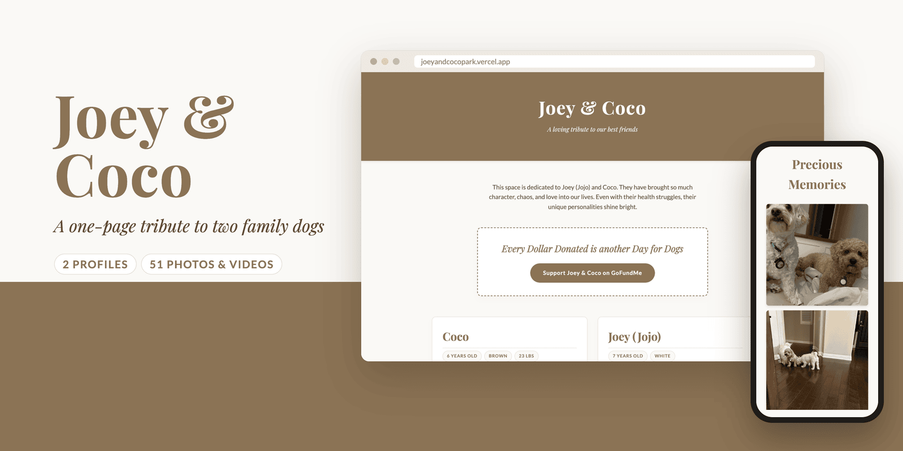
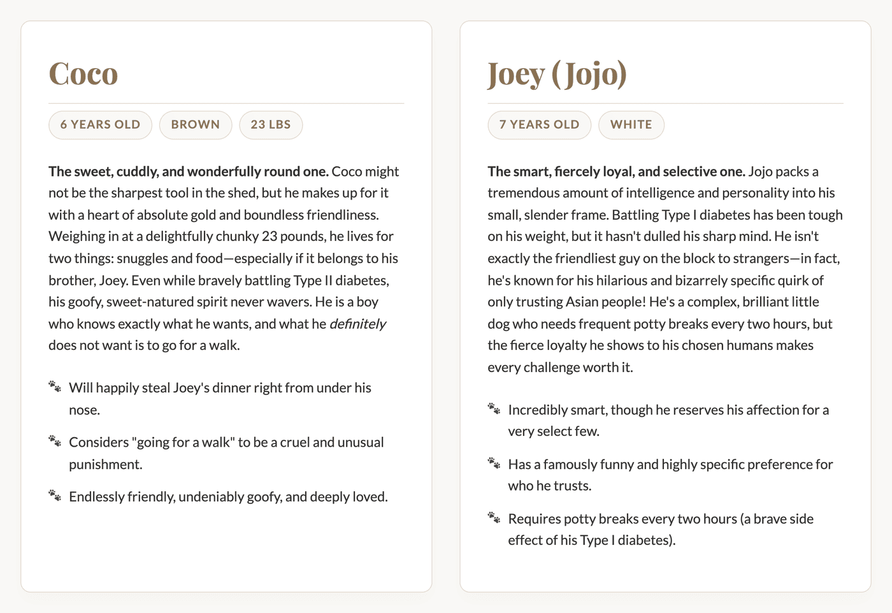
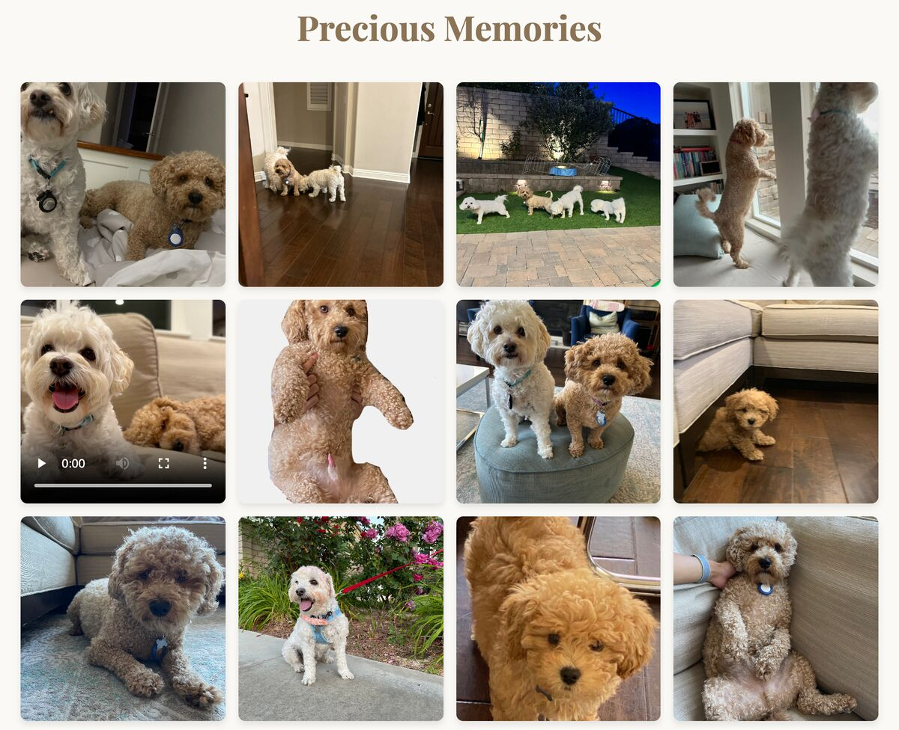
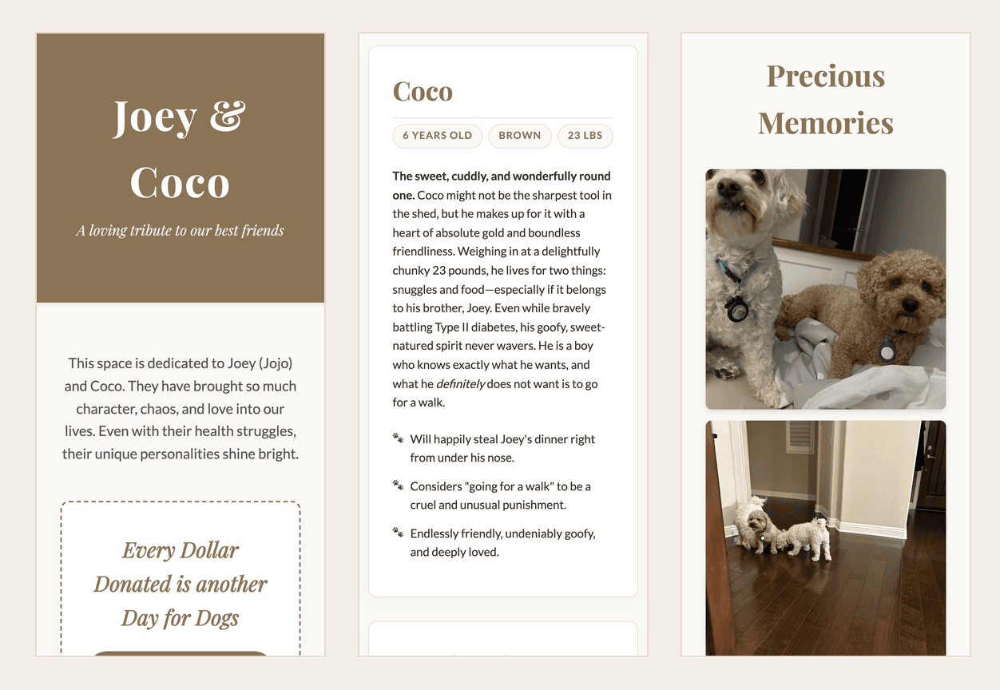

<p align="center">
  
</p>

<p align="center">
  <b>A one-page tribute site for Joey and Coco, two family dogs.</b><br>
  It introduces each dog, links to a fundraiser for their care, and shows 48 photos and 3 videos of them.
</p>

<p align="center">
  
  
  
  
  
</p>

<p align="center">
  <a href="https://joeyandcocopark.vercel.app">Live site</a> ·
  <a href="#whats-on-the-page">What's on the page</a> ·
  <a href="#run-it-locally">Run it locally</a> ·
  <a href="#files">Files</a> ·
  <a href="#known-limitations">Known limitations</a>
</p>

> [!NOTE]
> This project is archived and no longer updated. The live site may still load, but its content, including the fundraiser link, isn't maintained.

## Why

Joey and Coco both live with diabetes: Joey with Type I and Coco with Type II. This page gives family and friends one place to see who the two dogs are, look through photos of them, and support them through a GoFundMe fundraiser.

## What's on the page

The page is one HTML file and one stylesheet, with no JavaScript. It reads top to bottom in four parts.

**1. A header, a short dedication, and a donation box.** The donation box holds a single button that opens the dogs' GoFundMe page in a new tab. The hero image at the top of this README shows this part.

**2. A profile card for each dog.** Each card lists tags for age and coat color (plus weight for Coco), a short personality write-up, and three traits marked with paw prints.

<p align="center">
  
</p>

**3. A Precious Memories gallery.** Photos and videos sit in square tiles on a grid that fits as many 200 px columns as the screen allows. Videos play inline with the browser's own controls.

<p align="center">
  
</p>

<sub>Shows the first three rows of the gallery. The full page has 51 tiles.</sub>

**4. A footer:** "Forever in our hearts, Joey and Coco."

### On a phone

The profile cards stack into one column and the gallery drops to one photo per row.

<p align="center">
  
</p>

<sub>All screenshots are from the real page, served locally and captured with headless Chrome at 1440 px (desktop) and 390 px (phone) wide.</sub>

## Design

- **A warm, quiet palette.** Five CSS variables in `style.css` set the colors: an off-white background, a brown accent (`#8b7355`) for headings and buttons, and a beige border.
- **Two typefaces.** Playfair Display, a serif, sets the headings and italic lines. Lato sets the body text. Both load from Google Fonts.
- **Square, cropped tiles.** Each gallery tile uses `aspect-ratio: 1 / 1` and `object-fit: cover`, so portrait and landscape photos line up in an even grid.
- **No build step.** The site is static files only, so any web server or Vercel's static hosting can serve the folder as is.

## Run it locally

To view the page, open `index.html` in a browser. To serve it the way the live site does, run a static server from the repository root:

```sh
python3 -m http.server 8000
```

Then open <http://localhost:8000>. The page loads its fonts from Google Fonts, so it needs a network connection to show the right typefaces.

## Files

| Path | What it holds |
|---|---|
| [`index.html`](index.html) | The whole page: header, dedication, donation box, profile cards, gallery, and footer |
| [`style.css`](style.css) | Colors, typography, card and tag styles, the gallery grid, and hover effects |
| [`Pics/`](Pics/) | 48 photos and 3 `.MOV` videos used by the gallery, plus 33 `.HEIC` originals the page doesn't use |
| `Pics/instructions.txt` | The original notes about each dog that the page text was written from |
| [`.github/media/`](.github/media/) | Images for this README |

## Known limitations

- **Generic alt text.** Every gallery photo has the same alt text, "Memory of Joey or Coco", so a screen reader can't tell the photos apart. The videos have no captions.
- **Heavy page.** The gallery loads full-size phone photos with no thumbnails, and `Pics/` holds about 181 MB. `loading="lazy"` defers offscreen photos, but it has no effect on the `<video>` tiles.
- **Video formats.** Two of the three videos are HEVC (H.265) `.MOV` files, which not every browser can play.
- **Unused originals.** The 33 `.HEIC` files (about 56 MB) are committed but never referenced by the page.

## Credits

Made by Noel Sason in May 2026. The repository has no license file.
